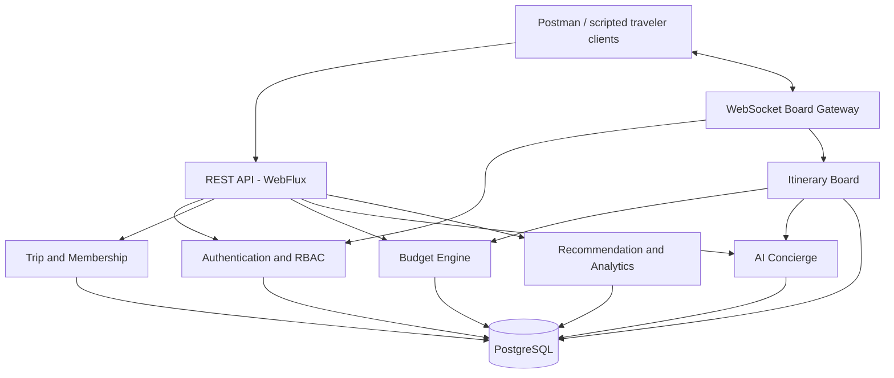

# Architecture

## Project shape

The first delivery is a **single Spring Boot application** organized by business capability. It exposes REST APIs and a reactive WebSocket gateway while keeping domain logic independent of transport concerns.

## Package structure

Base package: `com.manohar.aitripwarroom`

- `config` — application and infrastructure configuration.
- `common` — shared API errors, response types and utilities.
- `auth` — registration, login, JWT issuance and token validation.
- `user` — user profile and preferences.
- `trip` — trip rooms, invitations and memberships.
- `venue` — destination and venue metadata ingestion/search.
- `itinerary` — itinerary items, lifecycle and concurrency control.
- `collaboration` — WebSocket connections, presence and chat.
- `budget` — expenses, splits and per-person totals.
- `voting` — contested-slot vote lifecycle and resolution.
- `concierge` — deterministic constraints, retrieval and grounded AI responses.
- `recommendation` — content-based and collaborative recommendation baseline.
- `analytics` — trip history and session metrics.

Each feature package should own its controller/handler, service, repository, domain model and DTOs where applicable. Avoid one giant global controller or service.

## Data ownership and modeling decisions

- A user's role in a trip belongs to the trip membership, not to the user globally. A person can lead one trip and view another.
- Platform-level administration is separate from trip-level roles.
- Money is represented with `BigDecimal`, never floating-point types.
- Itinerary items carry a monotonically increasing `positionVersion`.
- Board mutation requests include the version last observed by the client. The server accepts a mutation only when that version matches the current version, then increments it. Stale writes receive the authoritative state and a conflict response.
- Venue dietary tags are modeled explicitly so every active dietary requirement can be checked deterministically.
- Important domain transitions and collaboration events are persisted so session analytics can be reconciled.

## Reactive I/O and JPA

The WebSocket gateway uses WebFlux/Reactor. JPA is blocking. Do not execute JPA calls on Reactor event-loop threads. Any blocking persistence operation invoked from a reactive flow must be isolated on a bounded blocking scheduler, with transaction boundaries kept inside the blocking operation.

This is an intentional boundary for this learning project. If the persistence workload later becomes fully reactive, evaluate R2DBC as a separate architectural change rather than mixing JPA and R2DBC casually.

## Initial consistency model

PostgreSQL is the durable source of truth. A room-scoped in-memory representation may be used for active collaboration, but database writes and version checks remain authoritative. This first version is a single application instance; a multi-instance deployment would need shared room/event coordination and is not claimed by the initial scope.

## Security boundaries

- Authenticate REST requests with JWT.
- Authenticate WebSocket handshakes and authorize each room-sensitive event.
- Enforce Viewer, Planner, Leader and Admin permissions on the server.
- Keep database credentials, JWT keys and external AI credentials outside source control.
- Validate and sanitize untrusted content at the API boundary.

## External integrations

Venue, lodging, transit and weather data are locally authored sample data. The AI model receives only retrieved, filtered venue context. The model does not decide whether a venue passes hard constraints and must not invent venues or metadata.
