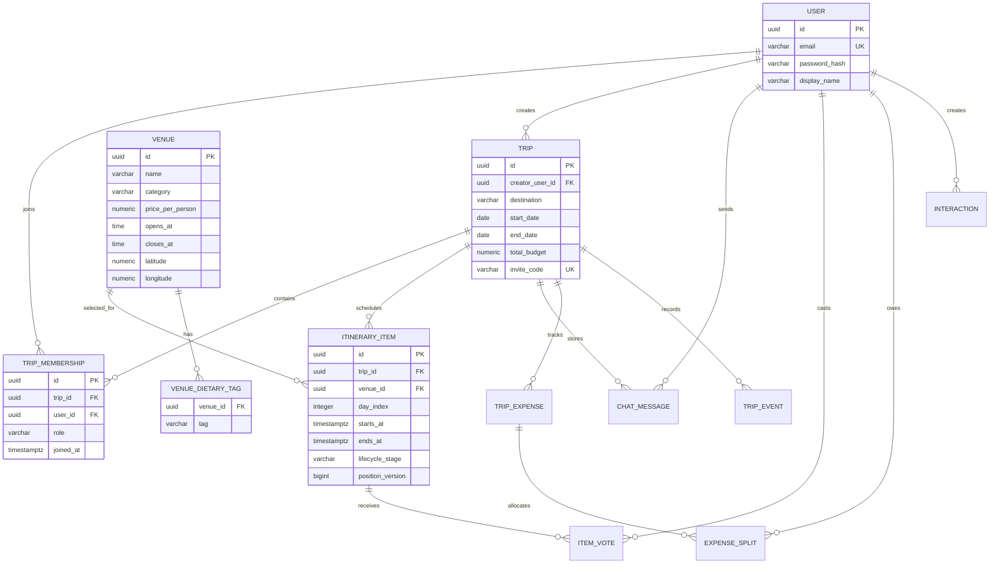

# Initial Relational Data Model

This is the proposed starting model for PostgreSQL. It will be refined against use cases before the first entity implementation.

## Main relationships

## Tables and responsibilities

| Table | Responsibility |
|---|---|
| `users` | Account identity and password hash |
| `trips` | Destination, dates, creator, budget and invite code |
| `trip_memberships` | User-to-trip membership and trip-specific role |
| `venues` | Structured destination venue metadata |
| `venue_dietary_tags` | Dietary tags supported by each venue |
| `itinerary_items` | Scheduled venue references and board lifecycle |
| `item_votes` | One participant's vote per contested item |
| `chat_messages` | Persisted participant, AI and system messages |
| `trip_expenses` | Expense amount, payer and split strategy |
| `expense_splits` | Exact amount allocated to each participant |
| `interactions` | Likes and other signals for recommendations |
| `trip_events` | Auditable events used to reconcile session analytics |

## Important constraints to implement

- Unique user email and unique trip invite code.
- Unique (`trip_id`, `user_id`) membership.
- One vote per user per itinerary item.
- Unique (`venue_id`, `tag`) dietary tag.
- Positive venue prices and expense amounts.
- Latitude in [-90, 90] and longitude in [-180, 180].
- Itinerary end time must be after start time.
- `position_version` starts at zero and increments on each accepted move.
- Monetary columns use `NUMERIC(12, 2)` (Java `BigDecimal`).
- Use UTC instants for scheduled events and preserve the trip's destination timezone for display/validation.

## Design notes

A trip-specific role lives on `trip_memberships`: the same user may be a Leader on one trip and a Viewer on another. Platform administration is a separate authority and must not be inferred from trip membership.

The PRD names six core entities. The membership, expense/split and event tables above are proposed supporting entities needed to model authorization, exact budget allocation and auditable analytics. They are design decisions for this implementation, not a verbatim reproduction of the source schema.
